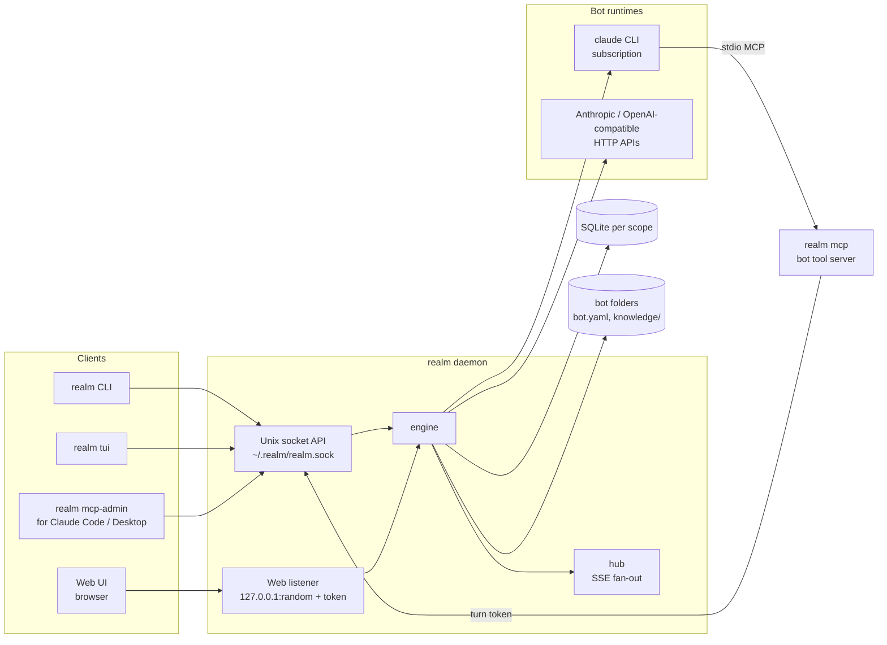
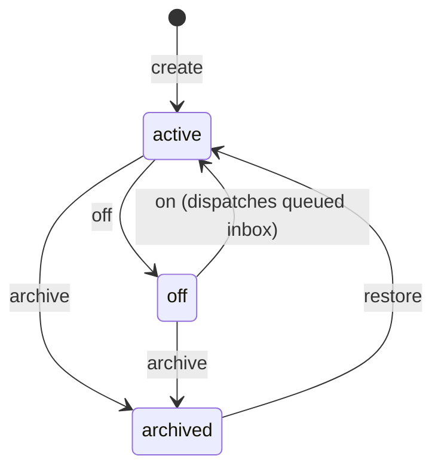
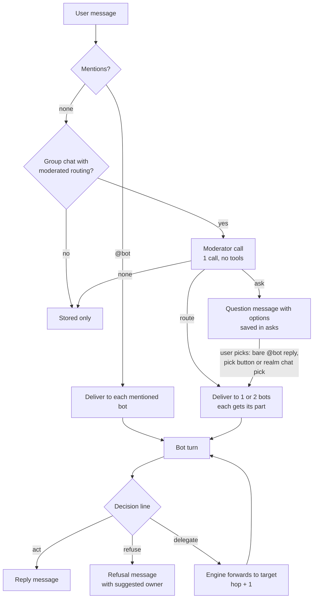
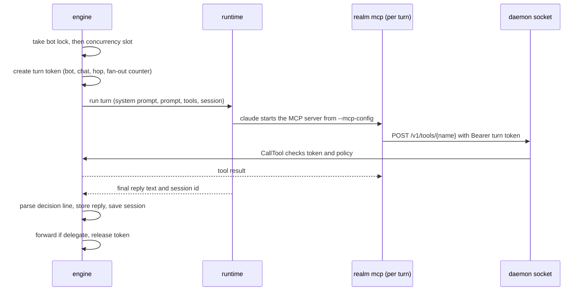

# Architecture

Realm is one Go binary, `realm`. It runs as a CLI, a long-lived daemon, two
stdio MCP servers and a terminal UI. The daemon owns all state and runs every
bot turn. Every other process is a client of the daemon.

Design decisions and their reasons are in [docs/adr](adr). This page describes
what the code does today. Endpoint and tool details are in [API.md](API.md).
Step-by-step flows are in [USAGE.md](USAGE.md).

## Components



| Package | Role |
| --- | --- |
| `cmd/realm` | Entry point. Calls `internal/cli`. |
| `internal/cli` | Cobra commands. Starts the daemon on demand and talks to it through `internal/client`. |
| `internal/daemon` | HTTP+JSON API on the unix socket (`server.go`) and the token-guarded web listener (`web.go`). |
| `internal/client` | Typed Go client for every daemon endpoint, plus `Stream` for SSE. |
| `internal/engine` | The core: chats, routing, the moderator, turns, tool calls, bot and knowledge management, onboarding. |
| `internal/router` | Moderator prompt and decision parsing. Pure. |
| `internal/gate` | Charter decision-line parsing. Pure. |
| `internal/policy` | Access policy (`CanAccessChat`, `CanDM`, `DMScope`). Pure. |
| `internal/mention` | `@mention` parsing. Skips code fences, inline code and quotes. |
| `internal/prompt` | Builds the system prompt and turn prompt for a bot. |
| `internal/runtime` | `claudecli` runner (builds `claude` flags, parses `stream-json`) and `apiprovider` runner (native tool loop). |
| `internal/tools` | Realm tool definitions for bots, and read-only file tools for API-key bots. |
| `internal/mcpserver` | Minimal stdio JSON-RPC MCP server, used by `realm mcp` and `realm mcp-admin`. |
| `internal/adminmcp` | The 20 realm-admin tools. Each one calls the daemon through the client. |
| `internal/store` | One SQLite database per scope. |
| `internal/bot`, `internal/knowledge` | Bot folders and knowledge notes on disk. |
| `internal/config` | Scopes, paths and `config.yaml`. |
| `internal/tui` | Bubble Tea terminal UI. |
| `internal/webui`, `web/` | React + Vite + TS app, built into `internal/webui/dist` and embedded with `go:embed`. |

## Scopes and storage

A scope is either `global` or a registered project, named by its slug.

```
~/.realm/                      global scope (override with REALM_HOME), mode 0700
  config.yaml                  providers, moderator model, limits
  realm.db                     global chats, messages, sessions, inbox, asks, project registry
  realm.sock                   daemon socket, mode 0600
  bots/<name>/
    bot.yaml                   definition
    knowledge/INDEX.md         index added to every turn
    knowledge/<id>.md          one note per file, mode 0600
    workspace/                 working folder for a global bot's claude runs

<project>/.realm/              project scope
  realm.db                     the project's chats and messages
  bots/<name>/...              same layout as global bots
```

If `~/.realm/realm.sock` would be 100 characters or longer (the unix socket
path limit), the daemon uses a per-home socket path in the temp folder.

Each `realm.db` has these tables:

| Table | Holds |
| --- | --- |
| `projects` | Slug and root folder of each registered project. Only the global database uses it. |
| `chats` | Group rooms and DM threads: id, kind, scope, name, routing. |
| `chat_members` | Extra members added to a chat, such as global bots in a project chat. |
| `messages` | The message envelope (see [API.md](API.md#message-envelope)). |
| `sessions` | `claude` session id per bot per chat, so later turns resume the session. |
| `inbox` | Work queued for a bot that is `off`. It is dispatched when the bot is turned on. |
| `asks` | Pending moderator questions and their options, so a bare `@bot` reply or a pick can answer them. |

IDs:

- Chat ids are `<scope>/<name>`, for example `my-app/dev` or `global/lobby`.
- DM ids are `<scope>/dm:<a>+<b>`, with the two handles sorted.
- Message ids are monotonic. A 12-hex-digit millisecond time and a 4-hex-digit counter are followed by 4 random hex digits, so ids sort in creation order even within one millisecond.

## Bots

A bot is a folder. `bot.yaml` holds the name, role (`bot` or `moderator`),
status, provider, model, effort, charter, topics, skills, tools and lineage.

Handles are `@<scope>/<name>`. A short `@name` resolves in the caller's
project first, then in the global scope.

Lifecycle:



- An `off` bot queues incoming work in `inbox`.
- An `archived` bot rejects messages.
- Knowledge is kept in every state.
- `InheritKnowledge` copies every note from one bot into another and records the source in `lineage`.

A scope gets a moderator bot (role `moderator`, handle `@<scope>/moderator`)
when its first moderated chat is created, or when a chat is switched to
moderated routing.

## Message flow

Bots never pick up messages on their own. A turn runs only when the engine
delivers a message to a specific bot.



**Delivery.** For each target bot the engine checks the access policy, then
queues a job. If the bot is `off`, the job goes to `inbox` instead.

**Moderator.** The moderator runs one call through the configured moderator
model (`haiku` by default). It uses `--system-prompt`, no tools and a short
history window. Its reply is one JSON object:

```json
{"action":"route","to":[{"bot":"@handle"}],"reason":"..."}
{"action":"route","to":[{"bot":"@a","text":"part for a"},{"bot":"@b","text":"part for b"}],"reason":"split request"}
{"action":"ask","options":["@a","@b"],"question":"...","reason":"..."}
{"action":"none","reason":"..."}
```

At most 2 targets are routed. The engine posts a `system` line naming the
route, or a `question` message for `ask`.

**Routing hints.** Picks, reroutes and misroute refusals are saved as notes in
the moderator's knowledge. Its `INDEX.md` is in every moderator call, so it
routes better over time.

**Mention-only chats.** With `routing: mention`, a message without `@` is stored
and nothing runs.

**Mentions that do not trigger.** An `@name` inside a code fence, inline code
or a quote is ignored. An `@name` in a bot's reply is display only.

## Turn execution



1. **Locks.** The engine takes the bot's lock first, then a slot from the global semaphore (`max_concurrent`, default 3). This order stops a busy bot from holding slots other bots need.
2. **Turn token.** A random token maps to the turn's identity: bot, chat, hop count and how many `send_dm`/`delegate` calls it has made. Realm tools act as that bot, and only while the turn runs.
3. **Prompt.** The system prompt holds:
   - the charter and the decision-line rules
   - the bot's knowledge `INDEX.md`
   - the chat's members and their charters

   The turn prompt holds recent chat history (`history_messages`, default 20) and the trigger message. A resumed `claude` session gets only the messages after its last reply.
4. **Runtime.**
   - `claude-cli`: see [claude-cli flags](#claude-cli-flags). A project bot runs in the project folder. A global bot runs in its `workspace/` and gets `--add-dir <project>` when it works in a project chat.
   - API-key providers: one HTTP conversation with a native tool loop. Realm tools and the read-only `read_file`, `grep` and `glob` tools run inside the daemon.
5. **Decision.** The first line of the reply is a JSON decision (`act`, `refuse` or `delegate`). A reply without one counts as `act`.
6. **Forwarding.** On `delegate`, the engine sends the request to the target with `hop + 1`. The target applies its own charter.

### claude-cli flags

```
claude -p --output-format stream-json --verbose
  --model <model> --effort <effort>
  --append-system-prompt <system prompt>          (moderator: --system-prompt)
  --session-id <uuid> | --resume <uuid>
  --tools <built-ins>                             (always passed; empty = none)
  --allowedTools <tools> Skill(<name>) mcp__realm
  --disallowedTools Read(//<realm dirs>/**) Edit(...) Write(...)
  --permission-mode dontAsk
  --setting-sources user,project              (project bot; global bot: user; moderator: local)
  --add-dir <project>                             (global bot in a project chat)
  --mcp-config <per-turn file> --strict-mcp-config
env: MCP_CONNECTION_NONBLOCKING=false
stdin: the turn prompt
```

The per-turn MCP config starts `realm mcp` with `REALM_TURN_TOKEN`,
`REALM_SOCKET` and `REALM_HOME`. The file is deleted when the turn ends.

## Security boundaries

| Boundary | Enforcement |
| --- | --- |
| Which chats a bot can reach | `policy.CanAccessChat`. Global bots reach any chat. Project bots reach only their own project's chats. Checked on delivery and on every tool call. |
| Who a bot can message | `policy.CanDM`. Project bots reach their own project's bots and global bots. |
| What a bot acts on | Charter gate: the decision line. Refusals suggest an owner. |
| Built-in tools | Explicit allowlist (default `Read, Grep, Glob`). An empty list passes `--tools ""` (none), never "all". |
| Realm data | Deny rules stop `claude` bots from reading or writing `~/.realm` and `<project>/.realm`. Knowledge goes through realm tools only. Realm home is `0700`; databases and notes are `0600`. |
| API-key file tools | Confined to the project folder. Symlinks are not followed. |
| Bot tool endpoint | `/v1/tools/*` exists only on the unix socket. It needs a live turn token. |
| Runaway loops | One turn per bot at a time and `max_concurrent` 3. Hop limit is `max_hops` 4. Delegation cycles are rejected. A turn can make at most 3 `send_dm`/`delegate` calls. One user message can cause at most 12 bot turns. |
| Web UI | Binds to `127.0.0.1` only and needs a per-launch token. Host and Origin are checked; CSP is set. It serves only the shared routes: never tools, shutdown or UI start. |
| Shutdown | The engine stops taking new work once `Close` starts, then waits for running turns. |

Bots run as your OS user. A bot granted `Bash`, `Edit` or `Write` has your
user's power over files and the daemon socket.

## Interfaces

All interfaces call the same daemon routes, so behavior is identical.

| Interface | Transport | Notes |
| --- | --- | --- |
| CLI | Unix socket | Starts the daemon on demand. |
| TUI | Unix socket | `internal/tui` uses the client through a small `API` interface, so tests use a fake. |
| Web UI | TCP `127.0.0.1` | `realm ui` asks the daemon (`POST /v1/ui`) to start the listener once and prints `http://127.0.0.1:PORT/#token=…`. The app stores the token for the tab, then sends it as `Authorization: Bearer`. SSE sends it as a `token` query parameter. |
| Admin MCP | stdio, then unix socket | `realm mcp-admin` exposes 20 management tools that act as you. |
| Bot MCP | stdio, then unix socket | `realm mcp` is started by `claude` for each turn and exposes the realm tools. |

## Build and test

- `make web` builds `web/` into `internal/webui/dist`. The built files are committed, so `go install` works without Node.
- `make test` runs `go test -race ./...`.
- `make check` runs the full local gate.
- CI runs two jobs:
  - Go job: `gofmt`, `go vet`, race tests and a coverage gate of at least 80% over `internal/...`, excluding `cli` and `cmd`.
  - Web job: `tsc`, `vitest`, and a check that the embedded build is current.
